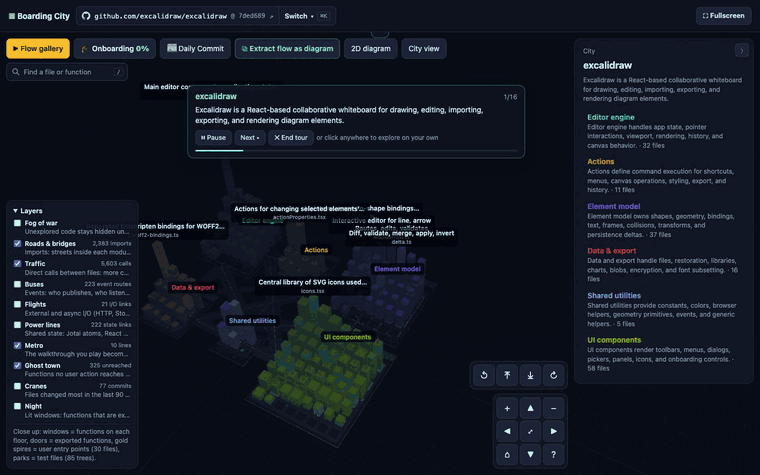

# Boarding City

Boarding City turns a JavaScript/TypeScript repository into a 3D city you can explore. Files are buildings, functions are floors, folders are districts. Then it walks you through real user actions, like "draw a rectangle" or "create a table", step by step through the code.

**Try it:** https://boarding-city.vercel.app (paste any public GitHub repo, or open the Excalidraw and Supabase cities).



[Watch the full 3-minute tour (MP4)](docs/demo.mp4)

## Features

- **Walkthroughs.** AI traces everyday user actions through the code. The camera flies a metro line from the first event handler to the visible result, with a sentence and `file:line` at every stop.
- **Every step is checked against the source.** A step is kept only if the function really exists in that file. Each hop is labelled *direct call* or *indirect* (event, callback, state) by reading the code, not by trusting the AI.
- **Function dive.** When a walkthrough stays inside one file, the building opens into its function floors.
- **Flow player.** Play, pause, next, previous, speed, loop and a step list. Jump to any step, during or after the run.
- **Extract a flow.** Turn any walkthrough into a clean 2D sequence diagram, then copy it as Mermaid, save it as PNG or share a link to it.
- **2D diagram.** One click flattens the city into a module and function chart.
- **City layers, all from static analysis:**
  - roads and bridges for imports
  - cars for calls
  - buses for events
  - flights to an airport for network and I/O
  - power lines for shared state
  - a metro for the selected walkthrough
  - cranes for recently changed files
  - night mode
- **Function → flows.** Click any function to see which user actions reach it. Shared helpers and infrastructure are grouped, so they don't flood the list.
- **Fog of war.** The city starts in fog and clears as you explore, with progress per district. Progress is saved only in your browser.
- **The Daily Commit.** A tabloid front page built from real numbers in the codebase ("APP.TSX HITS 11,499 LINES, STILL NO FINAL CHAPTER").
- **Ghost town.** Tumbleweeds roll past code that no user action reaches.
- **Navigation.** On-screen zoom, pan and rotate controls, keyboard shortcuts (press `?`) and fullscreen.
- **Find.** Jump to any district, file or function by name (press `/`).
- **Guided tour.** On a first visit the onboarding plays itself: the city, each district, the files where user actions start, the files everything depends on, then two walkthroughs. Click anywhere to take over.
- **What runs next? quiz.** Replay any walkthrough as a quiz: predict each next function (autocomplete, two tries, a hint), then read what that step does.
- **Onboarding badges.** City map, Front doors, Main streets, Commuter and Next-stop predictor make you ready for your first change; more for busy files, shared state, unreached code and reading the source. Progress stays in your browser.
- **Health layer.** Known design smells in red, computed from the import graph and history: import cycles as red bridges (Acyclic Dependencies Principle), hotspots as red haze (big files that keep changing: lines × commits), and hub files used by many and using many (⚠). Turn it on under Layers for a clickable report.
- **GitHub links.** Every file and function opens on GitHub at the exact commit and line.

## Quickstart

```bash
pip install -r requirements.txt
cp .env.example .env          # add your OpenAI API key
python -m boarding_city build excalidraw/excalidraw
open site/index.html          # or serve the folder: python -m http.server -d site
```

`build` accepts `owner/name` or a GitHub URL. Options are `--flows N` for the number of walkthroughs (default 6), `--key` and `--out`. Every step is cached per commit in `.cache/`, so rebuilding the same commit is free. `python -m boarding_city site` regenerates the repo list in `site/index.html`.

## Cost

The default models are `gpt-6-luna` for picking files, naming and headlines, and `gpt-6.1-terra` for traces. A city typically costs **$0.02 to $0.25**:

| Repo | Files | Cost |
|---|---|---|
| sindresorhus/ky | 31 | $0.02 |
| supabase/supabase | 6,847 | $0.10 |

Models are configurable in `.env`. Analysis, layers and verification use no AI at all.

## Build a city in the browser

On the hosted app, press **⌘K** (or **＋ Map a repo**), paste any public JS/TS GitHub repo, and press **Estimate**: you see the
source size, the expected time and the cost first. **Build city** starts it in the background. The skyline appears
within seconds, districts get their names one by one, and each walkthrough becomes playable as soon as it's traced
and checked. Settings: number of walkthroughs (or your own, like "export as PNG"), models, reasoning effort, max
files, and which features to include. Pin a commit with `owner/repo@<sha|branch|tag>` or a `github.com/owner/repo/tree/<ref>` URL (the CLI takes the same forms). Finished cities are cached per commit and settings, and every one gets a share
link. Guards: public GitHub only, up to 1,500 source files, 3 builds an hour per visitor, and a daily AI budget.
See [DESIGN.md](DESIGN.md) for how it runs on Vercel (background function with resumable stages, Blob storage).

## How it works

1. Shallow clone, deepened to the last 90 days for the cranes layer.
2. Static analysis: functions, imports, a call graph, and entry points (JSX and DOM handlers, registered actions, pages).
3. The fast model proposes user actions and shortlists their files. The trace model orders the steps.
4. Verification against the source. Unverifiable steps are dropped.
5. Layers, reach, the Daily Commit, then a single static page per repo, built with [three.js](https://threejs.org).

## Limitations

- JavaScript and TypeScript only.
- Static analysis misses some runtime wiring. Code marked unreached or indirect *may* still run dynamically, and the UI says so.
- Very large monorepos are summarised into folder blocks of about 200 buildings.

## Development

`node scripts/smoke.cjs` opens every built city headlessly and checks for console errors and the main UI. It needs `npm i -D playwright && npx playwright install chromium` first.

## Credits

The example cities include short code excerpts from [Excalidraw](https://github.com/excalidraw/excalidraw) (MIT) and [Supabase](https://github.com/supabase/supabase) (Apache-2.0); see [NOTICE](NOTICE). Rendering uses [three.js](https://github.com/mrdoob/three.js) (MIT).

## License

[MIT](LICENSE) © 2026 Albert Nahas
